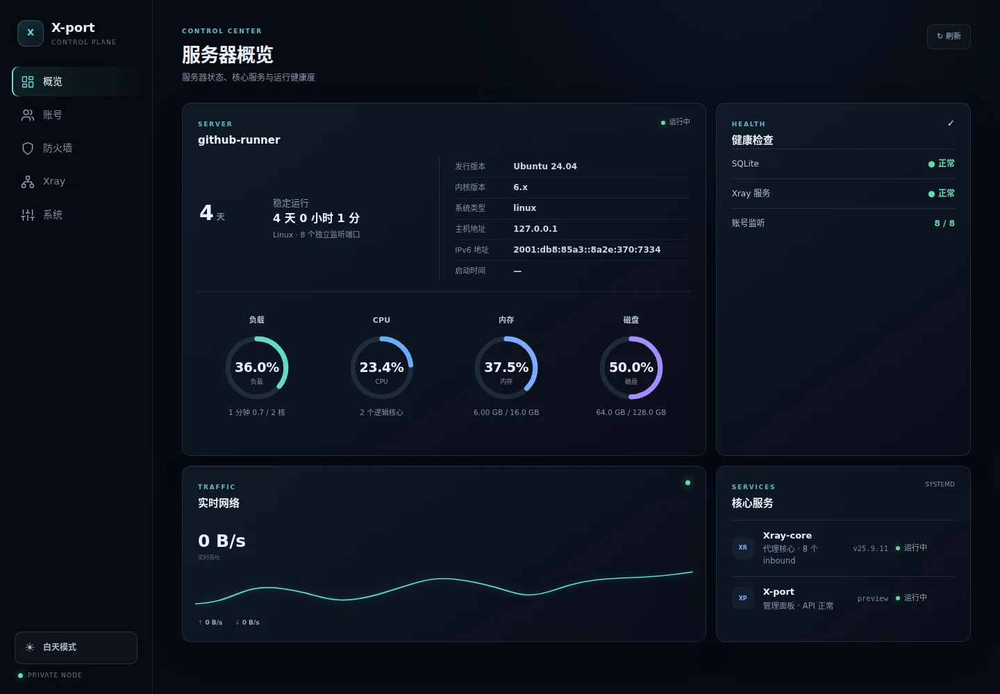
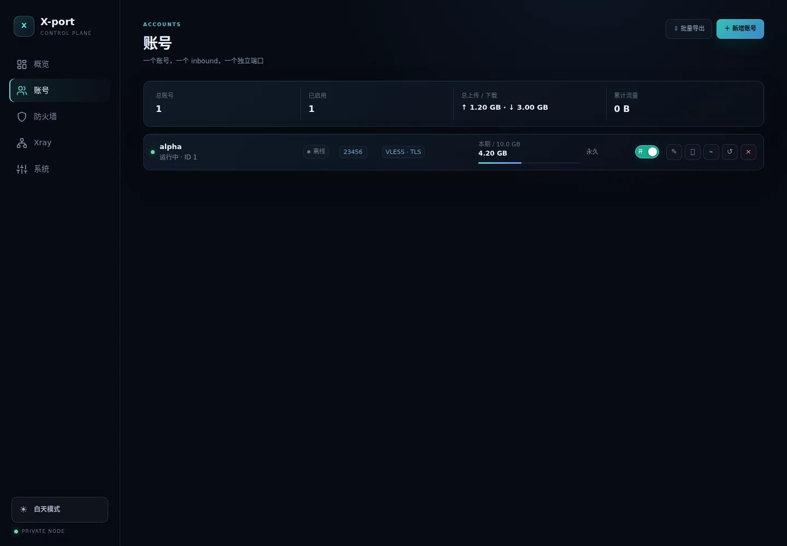
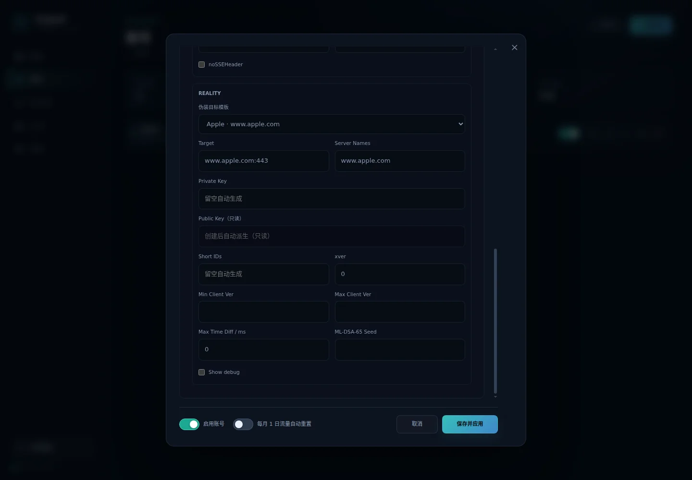
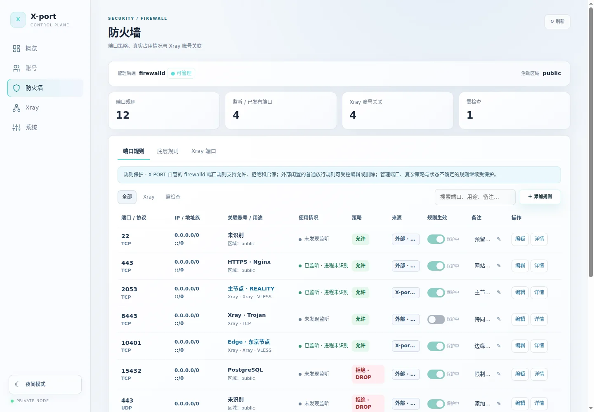
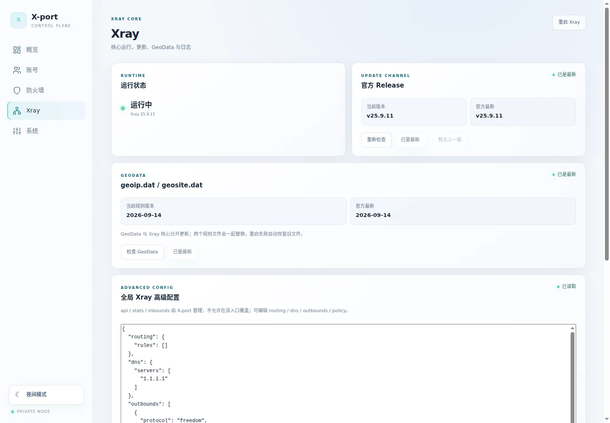
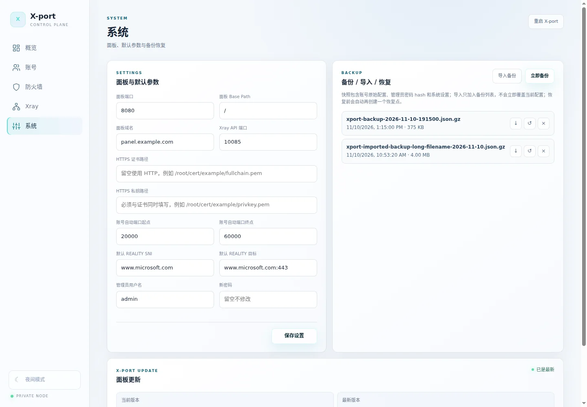

# X-port

<p align="center"><strong>A lightweight Xray control panel for personal Linux VPS servers</strong></p>
<p align="center"><a href="README.md">简体中文</a> · <strong>English</strong></p>

<p align="center">
  <a href="https://github.com/Kerberos255/X-port/releases/latest"></a>
  <a href="https://github.com/Kerberos255/X-port/actions/workflows/ci.yml"></a>
  <a href="https://github.com/Kerberos255/X-port/actions/workflows/security.yml"></a>
  <a href="LICENSE"></a>
</p>

<p align="center"></p>

> **One account = one Xray inbound = one dedicated port = one set of credentials.**
> The server is a single Go binary with an embedded WebUI and needs no Node.js runtime.

## Features

- **Overview** — CPU, memory, disk, traffic, service health, IPv4 and IPv6.
- **Accounts** — create, edit, clone, enable/disable and delete, traffic quotas, expiration, monthly reset, QR/share links and bulk export.
- **Protocols and transports** — VLESS, VMess, Trojan, Shadowsocks, SOCKS, HTTP; compatible transports include RAW, XHTTP, gRPC, WebSocket and HTTPUpgrade. REALITY + Vision is supported, with editable Target / Server Names presets.
- **Firewall** — inspect firewalld/UFW, listening ports and account associations; guarded management of simple rules. Safe, idle external firewalld allowances can be edited or removed with explicit consent and a **120-second independent recovery timer**. SSH, panel, active ports and complex rules are protected. Raw nftables is read-only.
- **Xray** — service status, logs, core and GeoData updates, config validation and rollback.
- **System** — panel settings, compressed backups, import/download, transactional restore and verified self-update with a restart watchdog.

## Interface previews

Screenshots are generated by browser regression tests using **mock data**, never production credentials.

| Accounts · dark | REALITY advanced options · dark |
|:---:|:---:|
|  |  |

| Firewall · light | Xray management · light |
|:---:|:---:|
|  |  |

<p align="center"></p>

Responsive light/dark themes, desktop sidebar and five-item mobile bottom navigation.

## Install

Supports **systemd Linux**, **amd64** and **arm64**. Install the latest stable GitHub Release:

```bash
curl -fsSL https://raw.githubusercontent.com/Kerberos255/X-port/main/install.sh | sudo bash
```

The installer verifies SHA-256 checksums and prompts for an administrator password. A fresh panel binds to `127.0.0.1:8080` by default; configure a secure HTTPS entry point for remote administration.

Open the terminal manager:

```bash
sudo xport
```

See [terminal manager documentation](docs/terminal-manager.md) and the [latest release](https://github.com/Kerberos255/X-port/releases/latest).

## Important notes

- Creating an account does **not** automatically open VPS firewall or cloud security-group ports.
- Keep SSH/console recovery access before changing management or firewall rules. Different firewall managers cannot provide atomic cross-process changes.
- Backups contain sensitive account data and administrator password hashes; handle them securely.
- For lawful personal use and small deployments, not multi-tenant or mission-critical hosting. Provided **as is** under [AGPL-3.0](LICENSE) without warranty.

## Development

Requires Go 1.27+. The static WebUI lives in `web/dist`.

```bash
go test ./...
go vet ./...
./scripts/build-linux.sh
```

The public `main` branch and tagged [Releases](https://github.com/Kerberos255/X-port/releases) are authoritative.
