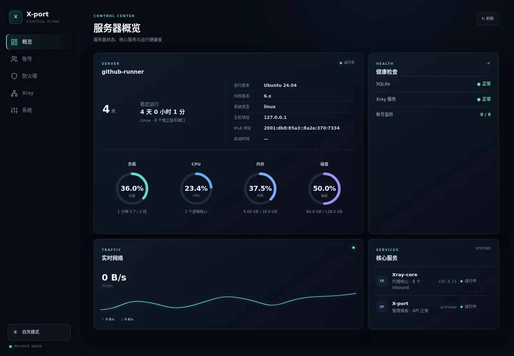
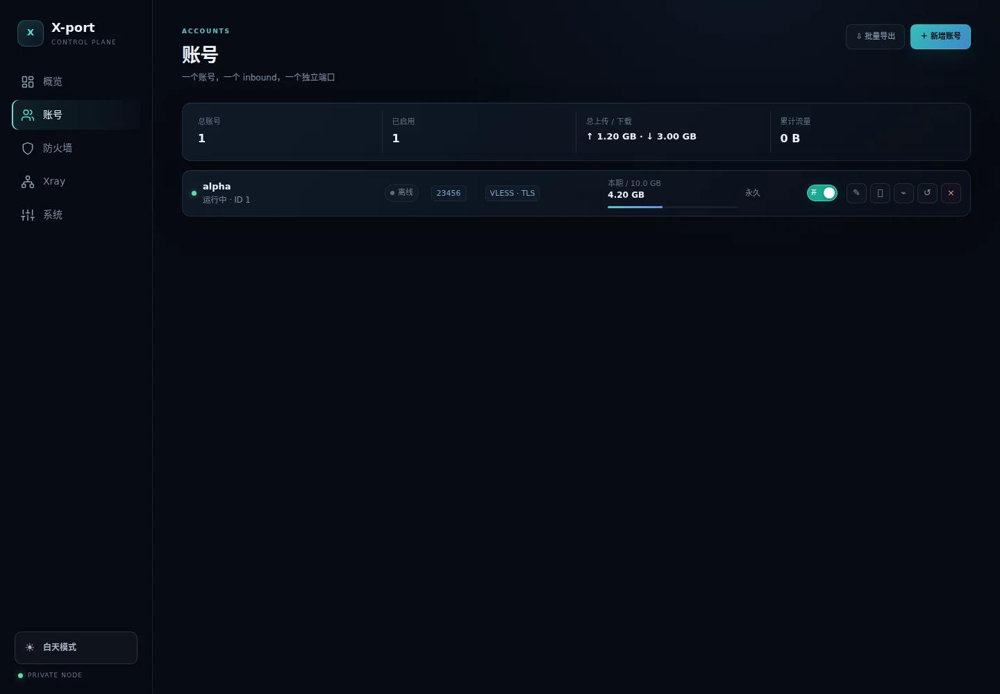
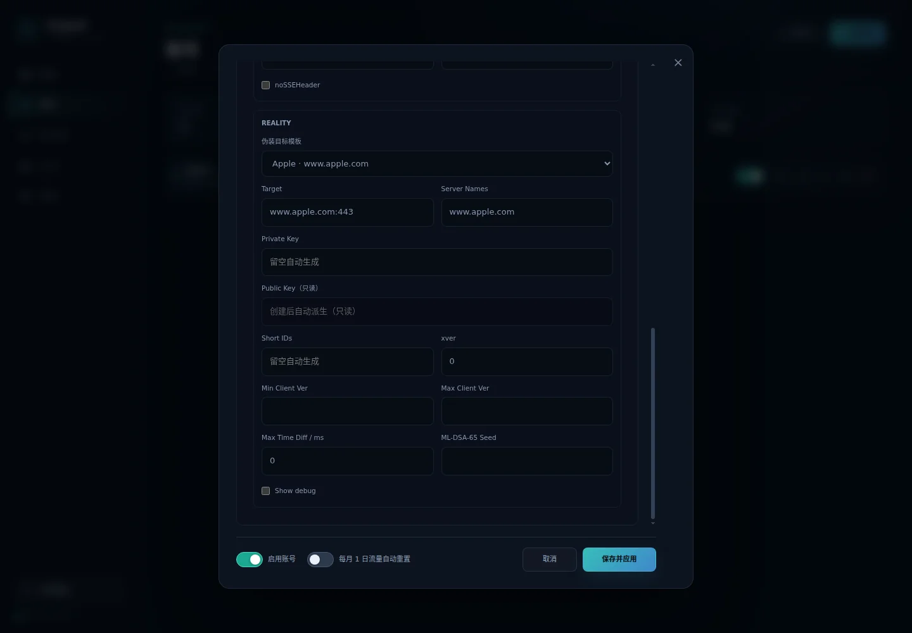
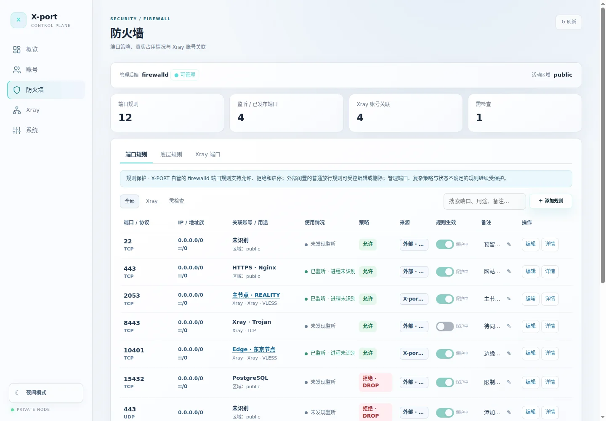
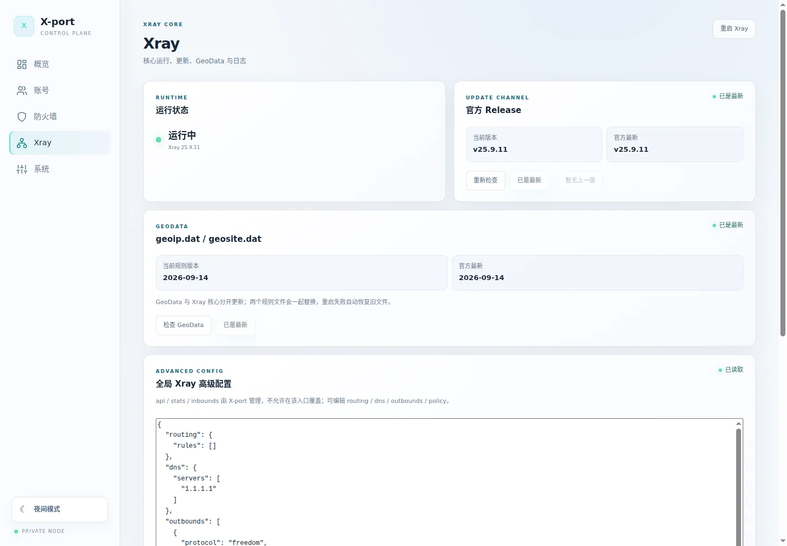
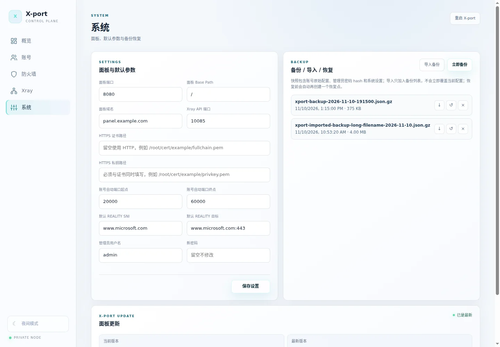

# X-port

<p align="center"><strong>面向个人 Linux VPS 的轻量级 Xray 管理面板</strong></p>
<p align="center"><strong>简体中文</strong> · <a href="README.en.md">English</a></p>

<p align="center">
  <a href="https://github.com/Kerberos255/X-port/releases/latest"></a>
  <a href="https://github.com/Kerberos255/X-port/actions/workflows/ci.yml"></a>
  <a href="https://github.com/Kerberos255/X-port/actions/workflows/security.yml"></a>
  <a href="LICENSE"></a>
</p>

<p align="center"></p>

> **一个账号 = 一个 Xray inbound = 一个独立端口 = 一组凭据。**
> 面板是单个 Go 二进制文件，内嵌 WebUI，服务器运行时不需要 Node.js。

## 主要功能

- **概览**：CPU、内存、磁盘、流量、服务健康、IPv4 / IPv6 信息。
- **账号**：新增、编辑、克隆、启停、删除、流量配额、到期限制、月度重置、分享链接、二维码和批量导出。
- **协议与传输**：VLESS、VMess、Trojan、Shadowsocks、SOCKS、HTTP；RAW、XHTTP、gRPC、WebSocket、HTTPUpgrade 等适用传输。支持 REALITY + Vision，提供可自定义的 Target / Server Names 模板。
- **防火墙**：检查 firewalld / UFW、监听端口及账号关联；受保护地管理简单规则。满足安全条件的闲置外部 firewalld 放行规则允许明确授权后编辑或删除；危险修改使用 **120 秒独立恢复机制**。SSH、面板、活跃端口和复杂规则受到保护，底层 nftables 只读。
- **Xray**：服务状态、日志、核心与 GeoData 更新，变更校验和失败回滚。
- **系统**：面板设置、压缩备份、导入/下载、事务式恢复，以及校验和与重启看门狗保护的面板升级。

## 界面预览

所有图片由自动化浏览器使用**模拟数据**拍摄，不含生产服务器数据或真实凭据。

| 账号管理 · 深色 | REALITY 高级配置 · 深色 |
|:---:|:---:|
|  |  |

| 防火墙 · 浅色 | Xray 管理 · 浅色 |
|:---:|:---:|
|  |  |

<p align="center"></p>

支持深色/浅色主题，桌面侧栏与手机五项底部导航。

## 安装

支持 **systemd Linux · amd64 / arm64**。从最新稳定 GitHub Release 安装：

```bash
curl -fsSL https://raw.githubusercontent.com/Kerberos255/X-port/main/install.sh | sudo bash
```

安装器校验下载文件的 SHA-256，并引导设置管理员密码。全新安装默认仅监听 `127.0.0.1:8080`；如需远程管理，应先设置安全的 HTTPS 入口。

安装后打开终端管理器：

```bash
sudo xport
```

参阅 [终端管理器说明](docs/terminal-manager.md) 和 [最新 Release](https://github.com/Kerberos255/X-port/releases/latest)。

## 使用前须知

- 新建账号**不会自动放行** VPS 防火墙或云平台安全组，需单独确认端口。
- 修改防火墙或管理端口前，保留 SSH / 控制台等备用管理入口；不同防火墙管理器不能保证跨进程原子变更。
- 备份包含敏感账号配置与管理员密码哈希，应妥善保存。
- 适用于合法的个人学习和小型部署，不用于多租户或关键业务托管。软件依 [AGPL-3.0](LICENSE) **按原样**提供，不附带担保。

## 开发

需要 Go 1.27+，静态 WebUI 位于 `web/dist`。

```bash
go test ./...
go vet ./...
./scripts/build-linux.sh
```

以公开仓库的 `main` 分支及正式 [Releases](https://github.com/Kerberos255/X-port/releases) 为准。
